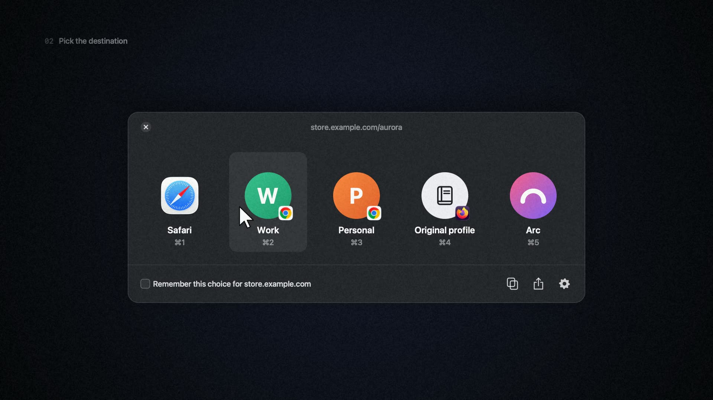

# Linkway

[](https://github.com/bohdanlevchenko/linkway/actions/workflows/ci.yml)

A small menu bar app for macOS that decides where your links open. Set it as the default browser and every link you click goes through it first. Linkway cleans the link, checks your rules and shows a picker only when no rule matches.

[](https://bohdanlevchenko.github.io/linkway/)

Watch the 40 second tour on the [project page](https://bohdanlevchenko.github.io/linkway/).

## Features

- Picker with a tile for each browser and profile. Press ⌘1, ⌘2 and so on to choose from the keyboard, hold ⇧ for a private window, or tick "Remember this choice" to turn the pick into a rule.
- Rules that match on host, subdomain, URL prefix, path, sender app or mail recipient domain. The first match wins, and a built-in tester shows which rule a URL hits without opening it. Hold ⌥ while clicking a link to get the picker anyway.
- Browser profiles for Chrome, Edge, Brave, Helium, Firefox and Zen, picked up automatically when you add or rename one.
- Tracking cleaner that strips `utm_*`, `fbclid`, `gclid`, `msclkid` and similar, and unwraps Google, Facebook and Outlook redirect links. Signed and login links are left alone.
- Optional short link expansion for bit.ly, t.co and friends.
- Deep links that open Figma, Linear, Notion, Zoom, Teams, Spotify, Discord and Slack web links in the desktop app when it is installed.
- `mailto:` links routed to a mail app or to Gmail, Outlook, Yahoo Mail, Fastmail or Proton Mail in the browser.
- A Chromium extension and a bookmarklet that hand the current page or any link to Linkway. See [Extensions/chromium](Extensions/chromium/README.md).

## URL scheme

Scripts, Terminal, AppleScript and web pages can hand links to Linkway:

```sh
# Route through your rules, like a normal click
open "linkway://open/https://example.com/docs"

# Always show the picker
open "linkway://prompt/https://example.com/docs"

# Strict form for callers that encode
open "linkway://open?url=https%3A%2F%2Fexample.com%2Fdocs"
```

Only `http`, `https` and `mailto` links are accepted. Choosy's `x-choosy://` commands (`open`, `prompt.all`, `prompt.running`, `best.all`, `best.running`) work too.

## Building

Needs macOS 14 or later and Swift 6.

```sh
swift build
swift test
scripts/bundle.sh            # release build into build/Linkway.app
scripts/bundle.sh --install  # also copy it to ~/Applications and register it
```

After launching, open Settings from the menu bar icon and make Linkway the default browser.

## Layout

- `Sources/LinkwayCore` holds the platform-independent parts: routing engine, URL matching, configuration, profile discovery for Chromium and Firefox, link cleaning, short link resolution, webmail and deep link adapters. Everything here is covered by tests.
- `Sources/Linkway` is the AppKit/SwiftUI app: link ingress, picker, settings, onboarding and launching.
- `Extensions/chromium` is the Manifest V3 extension. It has no build step.

Configuration lives in `~/Library/Application Support/io.github.bohdanlevchenko.linkway/configuration.json` and can be imported or exported from Settings.

## License

[MIT](LICENSE)
